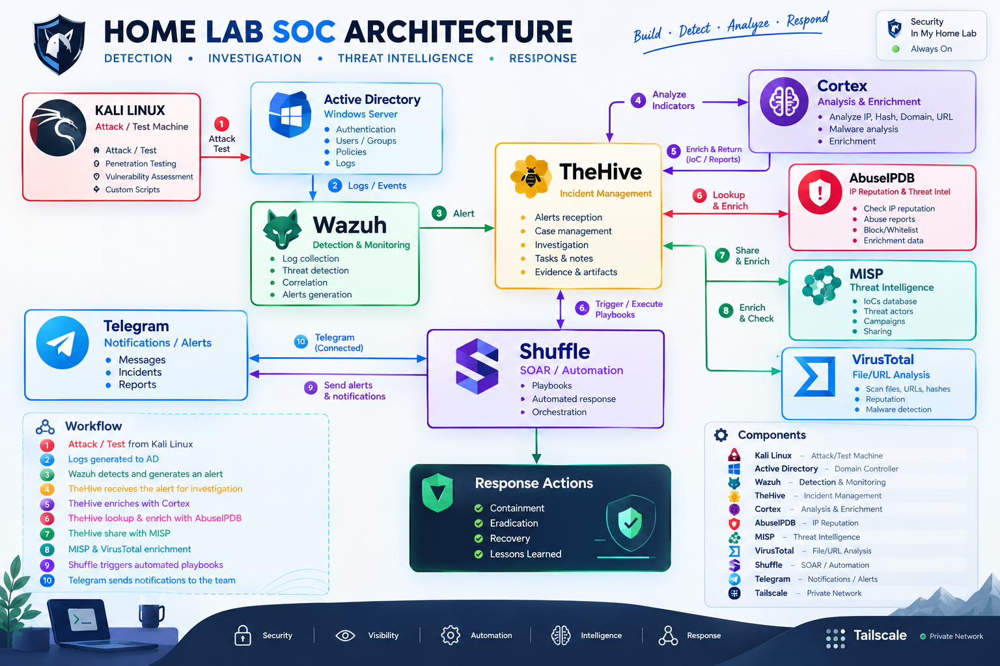

# Next-Gen AI-Driven SOC

Ce projet implemente un lab SOC oriente detection, triage et orchestration.



Cette image represente la chaine complete de detection, investigation, enrichment et reponse.

Objectif global:
- Detecter des attaques Linux et Windows avec Wazuh.
- Creer automatiquement des alertes TheHive.
- Enrichir les observables via Cortex et MISP.
- Piloter les actions analyste via Shuffle.

## Architecture detaillee

### 1) Zone attaque et generation des evenements

- Kali Linux joue le role machine d attaque/test.
- Active Directory (Windows Server) et les endpoints recoivent les actions de test.
- Les evenements de securite et reseau sont generes cote Windows et Linux.

Utilite:
- Simuler des scenarios reels (scan, brute force, activite suspecte) dans un lab controle.

### 2) Detection et correlation (Wazuh)

- Wazuh collecte les logs Linux et Windows.
- Les regles custom PHASE4 detectent:
	- scan TCP,
	- flood ICMP,
	- brute force,
	- comportements Sysmon (PowerShell encode, LOLBins, possible C2, etc.).
- Wazuh genere une alerte avec contexte technique (rule id, severite, host, champs event).

Utilite:
- Transformer un grand volume de logs bruts en alertes qualifiees et actionnables.

### 3) Gestion d incident (TheHive)

- Une integration Python (automation/wazuh_to_thehive.py) pousse l alerte vers TheHive.
- L alerte inclut:
	- titre standardise,
	- description detaillee,
	- severite mappee,
	- tags,
	- observables extraits automatiquement.
- sourceRef stable evite les doublons logiques sur une meme attaque repetee.

Utilite:
- Centraliser la gestion d incident et preparer le travail analyste sans duplication inutile.

### 4) Enrichment (Cortex, AbuseIPDB, MISP, VirusTotal)

- TheHive/Shuffle envoie les observables vers Cortex.
- Cortex execute les analyzers (AbuseIPDB, VirusTotal, MISP, autres).
- MISP apporte le contexte de threat intelligence interne/externe.

Utilite:
- Donner une priorisation basee sur des preuves (reputation IP, malveillance hash/url, correspondances TI).

### 5) Orchestration SOAR (Shuffle)

- Shuffle declenche les playbooks a la reception d alertes/cases.
- Le workflow consolide les resultats d enrichissement.
- Il cree les taches de decision et trace les etapes (audit trail).

Utilite:
- Standardiser les traitements et reduire le temps de reponse.

### 6) Notification et decision humaine (Telegram + analyste)

- Telegram envoie les notifications operationnelles.
- L analyste valide la decision finale:
	- bloquer IP,
	- isoler poste,
	- supprimer fichier,
	- desactiver compte,
	- publier IoC dans MISP.

Utilite:
- Garder l humain dans la boucle pour les actions a impact.

### 7) Reponse et boucle d amelioration

- Actions de reponse: containment, eradication, recovery.
- Lessons learned reinjectees dans:
	- regles Wazuh,
	- playbooks Shuffle,
	- politiques de priorisation.

Utilite:
- Amelioration continue de la qualite detection et de la vitesse de traitement.

## Flux operationnel resumee

1. Kali lance une simulation d attaque.
2. Les systemes cibles produisent logs et evenements.
3. Wazuh detecte et cree une alerte.
4. TheHive recoit et structure l incident.
5. Cortex/AbuseIPDB/MISP/VirusTotal enrichissent les observables.
6. Shuffle consolide et prepare la decision.
7. Telegram notifie l equipe SOC.
8. L analyste approuve ou rejette l action.
9. Les actions autorisees sont executees.
10. Le resultat est trace pour audit et amelioration.

Architecture fonctionnelle:
1. Wazuh collecte et corrige les evenements.
2. Regles custom PHASE4 detectent scans, brute force, flood, comportements Sysmon.
3. Integration Python pousse les alertes vers TheHive avec sourceRef stable (anti-duplication).
4. Shuffle orchestre l enrichissement et la decision analyste.
5. Cortex lance les analyzers (AbuseIPDB, VirusTotal, MISP, etc.).

## Lecture rapide pour un nouveau membre

1. Lire d abord docs/README.md puis docs/PHASE4_WAZUH_DOCKER.md.
2. Lire config/README.md pour comprendre les stacks et regles.
3. Lire automation/README.md pour comprendre la logique Wazuh -> TheHive.
4. Lire scripts/README.md pour deploiement et tests.

## Arborescence principale

- automation/: code d integration et tests locaux d extraction d observables.
- config/: toutes les configurations Wazuh, Cortex, MISP, Shuffle et variables d environnement.
- docs/: runbooks, guides de test et mode operatoire.
- scripts/: scripts de deploiement et de validation.

## Resultat attendu du projet

Quand tout est en place:
- Une attaque detectee cote Linux/Windows remonte dans Wazuh.
- Une alerte est creee dans TheHive avec observables exploitables.
- Les enrichissements donnent du contexte de priorisation.
- L analyste valide les actions de containment avec tracabilite.

## Demarrage rapide (commandes)

1. Creer le fichier d environnement:

```bash
cp config/.env.example config/.env
```

PowerShell:

```powershell
Copy-Item config/.env.example config/.env
```

2. Demarrer les stacks conteneurisees:

```bash
docker compose -f config/cortex/docker-compose.yml up -d
docker compose -f config/misp/docker-compose.yaml up -d
docker compose -f config/shuffle/docker-compose.yaml up -d
```

3. Appliquer PHASE4 sur le manager Wazuh Docker:

```bash
sudo PROJECT_DIR="$(pwd)" MANAGER_CONTAINER=single-node-wazuh.manager-1 bash scripts/apply_phase4_wazuh_docker.sh
```

4. Lancer les tests d attaque puis validation:

```bash
bash scripts/run_phase4_linux_attack_test.sh --target-ip 10.10.0.22
python3 scripts/validate_phase4_rule_ids.py --mode linux --container single-node-wazuh.manager-1
```

```powershell
powershell -ExecutionPolicy Bypass -File scripts/run_phase4_windows_attack_test.ps1 -TargetIp 10.10.0.33
python scripts/validate_phase4_rule_ids.py --mode windows --container single-node-wazuh.manager-1
```
